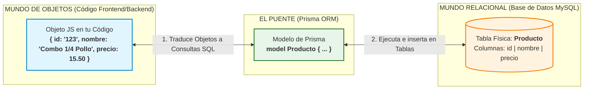
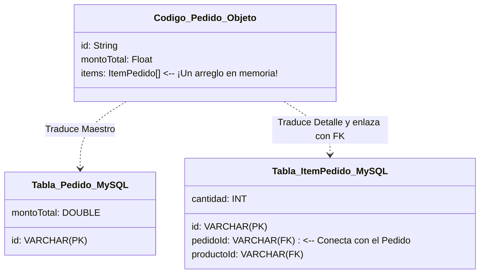

# 🍗 Explicación Práctica y Visual: Mapeo Objeto-Relacional (ORM)
### Diseñado especialmente para el Trabajo de Grado: **Gori Chicken**

Si te cuesta entender a qué se refiere el **Mapeo ORM** y cómo explicarlo en tu tesis, ¡no te preocupes! En este documento te lo explicamos con peras y manzanas, usando metáforas sencillas y ejemplos reales extraídos directamente de tu archivo `schema.prisma`.

---

## 1. La Metáfora del "Traductor Bilingüe" 🗣️
Imagina que dos personas quieren hacer negocios pero hablan idiomas completamente diferentes:

1. **El Programador (Tú):** Habla el **"Idioma Objeto"**. Piensa en términos de componentes, clases, variables, objetos y arreglos (JavaScript/TypeScript).
2. **La Base de Datos (MySQL):** Habla el **"Idioma Relacional"**. Piensa en términos de tablas, filas, columnas, llaves primarias y llaves foráneas.

Como no se entienden entre sí, contratan a un **Intérprete Bilingüe**: el **ORM (Prisma)**. 

> **Definición para tu tesis:**  
> *"El Mapeo Objeto-Relacional (ORM) es una técnica de programación que permite convertir datos entre el sistema de tipos de un lenguaje orientado a objetos (TypeScript/Vue) y el sistema de almacenamiento de una base de datos relacional (MySQL), utilizando un archivo de configuración (schema.prisma) como el diccionario de traducción."*

---

## 2. Diagrama del Flujo de Traducción 🗺️

Este diagrama de flujo muestra cómo Prisma conecta tu código en el frontend/backend con las tablas de tu base de datos:



---

## 3. Tres Casos Reales de tu Proyecto "Gori Chicken" 🎯

Para que lo entiendas con tu propio sistema, veamos tres ejemplos de cómo Prisma traduce tu código a la base de datos real:

### Caso A: Un Atributo Simple (La traducción directa)
Cuando quieres guardar el nombre y el precio de un producto, la traducción es muy directa:

* **En tu código (TypeScript):** Tienes una variable de texto (`string`) y una de número con decimales (`number`).
* **En el traductor (Prisma):** Defines `nombre String` y `precio Float`.
* **En la Base de Datos (MySQL):** Prisma crea físicamente una columna `VARCHAR(191)` para el texto y una columna `DOUBLE` para el precio.

```
[Código de tu App]                 [Prisma ORM]                [Base de Datos MySQL]
nombre (string)     =======>      nombre String    =======>    nombre VARCHAR(191)
precio (number)     =======>      precio Float     =======>    precio DOUBLE
```

---

### Caso B: El gran truco de magia (Relación Maestro-Detalle)
Aquí es donde la gente suele confundirse. Imagina que un cliente hace un **Pedido** que contiene varios **Items** (ej. 2 combos de pollo y 1 gaseosa).

* **En el código de tu App (Objetos):**  
  Para ti es muy natural guardar el pedido como un único objeto que dentro tiene una **lista/arreglo** de ítems. Ejemplo:
  ```json
  {
    "id": "pedido-001",
    "montoTotal": 35.00,
    "items": [
      { "productoId": "pollo-1", "cantidad": 2 },
      { "productoId": "gaseosa-1", "cantidad": 1 }
    ]
  }
  ```
* **El Problema Relacional:**  
  En las bases de datos relacionales (MySQL) **¡no existe el concepto de guardar una lista dentro de una celda de una tabla!** Todo tiene que ser plano.
* **La Solución del ORM:**  
  Prisma hace el truco de magia: toma esa lista en memoria, la divide y crea dos tablas físicas en tu MySQL vinculadas por una **Llave Foránea (`pedidoId`)**:



---

### Caso C: Arquitectura Multi-tenant (El núcleo de tu tesis)
Tu sistema es **Multi-tenant** (soporta múltiples sucursales de Gori Chicken en una sola base de datos de manera segura).

* **Cómo lo resuelve el ORM:**  
  En tu `schema.prisma`, casi todas tus entidades importantes (`Usuario`, `Producto`, `Receta`, `Pedido`) tienen una columna llamada `sucursalId`.
* **Mapeo del Filtro:**  
  Cuando en el código de tu frontend el administrador de la *"Sucursal A"* solicita ver sus ventas, el ORM intercepta la consulta y le añade automáticamente un filtro SQL `WHERE sucursalId = 'sucursal-A-uuid'`. 
  Esto garantiza que los datos estén lógicamente separados en la base de datos física, pero para ti en el código se sientan como simples objetos de tu sucursal.

---

## 4. Texto sugerido para copiar y pegar en tu Tesis (Redacción Académica) 📝

Puedes usar este texto formal en tu marco práctico o en la sección de diseño de software para explicar esta parte a tus evaluadores:

> *"Para la persistencia de datos y la comunicación entre la capa lógica de la aplicación (desarrollada en Node.js/Express) y la capa de almacenamiento (MySQL), se implementó el patrón de Mapeo Objeto-Relacional (ORM) a través de la herramienta **Prisma ORM**.*
>
> *Esta decisión arquitectónica resolvió la brecha de impedancia entre el paradigma orientado a objetos utilizado en el desarrollo de software y el modelo relacional de la base de datos. Mediante el archivo de definición `schema.prisma`, se automatizó el mapeo de tipos de datos, llaves primarias (mediante identificadores únicos universales - UUID) y llaves foráneas. Específicamente, relaciones complejas de negocio como el patrón Maestro-Detalle (ej. la relación entre un Pedido y sus correspondientes Ítems de Pedido) y el aislamiento de datos para la arquitectura multi-tenant (mediante la asociación lógica de entidades a una Sucursal) son gestionados transparentemente por el ORM, garantizando la consistencia transaccional y la integridad referencial en la base de datos."*

---

### 💡 Tip Final de Oro para tu Defensa de Grado
Si el jurado te pregunta: **"¿Por qué usaron un ORM en vez de escribir código SQL puro (SELECT, INSERT)?"**  
Tu respuesta debe ser:
1. **Velocidad de desarrollo:** Nos permitió desarrollar la aplicación mucho más rápido al no tener que escribir cientos de líneas de consultas SQL manuales.
2. **Seguridad integrada:** Prisma previene de forma automática ataques informáticos graves como la *Inyección SQL*.
3. **Mantenibilidad:** Si en el futuro decidimos cambiar de base de datos (por ejemplo, migrar de MySQL a PostgreSQL), solo debemos cambiar una línea en el archivo de configuración del ORM, en lugar de reescribir todo el código del sistema.
